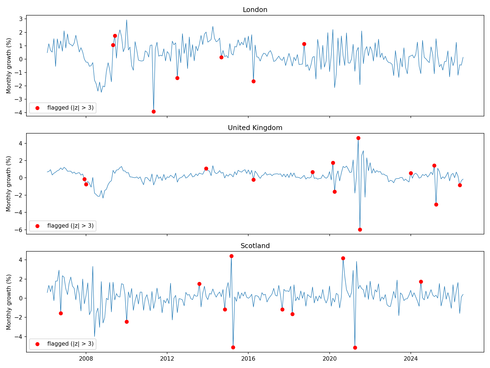

# UK-house-price-forecasting
**Question:** Does UK house price growth have momentum, which months were unusual, and can simple time-series models forecast it better than a naive guess?

**Status:** Data preparation, momentum and noise tests, a timing-shock analysis and a SQL anomaly detector are done. Forecast comparison is next.

The thinking behind each step, my predictions and the ideas I want to follow up are in the [research log](RESEARCH_LOG.md).

## Data
- Source: UK House Price Index, full file, gov.uk (August 2026 release)
- Column: AveragePriceSA (seasonally adjusted)
- Regions: London, Scotland, United Kingdom
- Sample: January 2005 to August 2026, monthly (about 260 months)

## Why these choices
- **Growth instead of price levels.** House prices rise over time, so price levels drift upwards. Models work better on monthly growth, which moves around a stable average. I use log growth: 100 × (log price this month − log price last month).
- **Seasonally adjusted prices.** There exists a stable seasonal pattern in real-estate sales, more houses statistically sell in summer and autumn. The adjusted series removes this pattern, so the analysis focuses on real changes. Other influencing patterns also assumed but not yet identified nor adjusted.
- **Start in 2005.** The UK HPI covers England and Wales from 1995, Scotland from 2004 and Northern Ireland from 2005, so the UK series only starts in 2005. I start all regions in 2005 so they cover the same period.
- **Older data removed.** The file goes back to 1968, but the early data shows flat months followed by sudden jumps, which is not real monthly movement. Distorts results and the measure of forecasting quality, therefore removed.

## Findings

### 1. Momentum lasts about six months
| Region | Lag-1 autocorrelation | Lag-3 autocorrelation |
|---|---|---|
| London | 0.22 | 0.41 |
| Scotland | −0.18 | 0.17 |
| United Kingdom | 0.01 | 0.56 |

- **Six-month pattern.** In all three regions, growth is significantly linked to growth in the past ~6 months, not further back. Forecasting models should therefore use about 3–6 past months.
- **Lag 1 alone is misleading.** The UK's lag-1 value is almost zero, its lag-3 value the strongest in the whole data.
- **Scotland zig-zags** month to month (negative lag 1). Likely reason: fewer recorded sales, so the monthly average is noisy. Still positive links at lags 2–8, momentum seems hidden under the noise.
- **Lag-3 peak not explained yet.** Could be the market, could be how the index is built.

### 2. It is not noise
| Test | London | Scotland | UK |
|---|---|---|---|
| Ljung–Box, 6 lags (p-value) | 2.7e-28 | 3.5e-06 | 9.3e-24 |
| Plain shuffle, lag 3 (p-value) | < 0.0001 | 0.0052 | < 0.0001 |
| Volatility-aware shuffle, 2 / 3 / 4 groups | < 0.0001 (all) | 0.015 / 0.024 / 0.032 | < 0.0001 (all) |

- **Shuffle tests** destroy the time order 10,000 times and check how often chance matches the real value.
- **Volatility-aware shuffle (my design).** Plain shuffling mixes calm and crisis months. My version only swaps months with similar volatility. London and the UK stay significant in every version. Scotland weakens as the test gets stricter, part of its evidence came from mixing calm and crisis periods, but it still passes at the 5% level.
- **Distance, not chart scale.** With about 260 months, noise autocorrelations spread by roughly 0.06, so the UK's 0.56 sits about 9 spreads from zero.
- **Length differs by region.** Ljung–Box evidence is strongest at 6 lags for London and the UK and weakens at 12. Scotland's keeps growing up to 12 lags.

### 3. Policy deadlines reverse, 2008 persisted
Tax deadlines change *when* people buy, not *how much* they want to buy, comparable to a firm buying extra stock one year and less the next. That should give a spike followed by a reversal. 2008 was a collapse in lending, so bad months should follow bad months. Test in SQL (`LEAD`): each large monthly move plus the following month. Close to 0 = reversal, clearly negative = persistent.

| Event | Spike month | Next month | Sum |
|---|---|---|---|
| UK, end of stamp duty holiday, step 1 | Jun 2021: +4.62 | −5.99 | −1.36 |
| UK, end of stamp duty holiday, step 2 | Sep 2021: +3.14 | −2.24 | +0.90 |
| Scotland, new property tax (LBTT), April 2015 | Mar 2015: +4.41 | −5.12 | −0.71 |
| London, first Covid lockdown | Mar 2020: +2.21 | −2.13 | +0.08 |
| Scotland, 2008 | Jun 2008: −3.99 | −1.55 | **−5.54** |
| UK, 2008 | Nov 2008: −2.35 | −1.47 | **−3.83** |

### 4. Risk signals: SQL anomaly detector
**Method (DuckDB, window functions).** For each month, average and standard deviation of growth over the **previous 12 months only**, like a real-time system that cannot see the future. Then a z-score: how many standard deviations the month lies from that recent normal. Flag if |z| > 3, threshold fixed before running.

| Region | Flags | Average \|z\| | Largest \|z\| | Largest \|z\| in 2008–09 |
|---|---|---|---|---|
| London | 7 | 1.0 | 6.74 | 3.33 |
| Scotland | 11 | 0.9 | 6.18 | 2.89 |
| United Kingdom | 13 | 1.1 | 9.17 | 4.42 |

- **Policy shocks dominate.** Flags line up with Scotland's new tax (March/April 2015), the second-home tax surcharge (April 2016), the first lockdown (March/April 2020), Scotland's tax holiday (2020–21), the end of England's stamp duty holiday (June/July 2021) and the end of the temporary stamp duty cuts (March/April 2025). April 2025 is the most extreme month in the data (z = −9.17).
- **Turning points, not slow crashes.** The deep 2008 crash months are mostly not flagged. Flagged is the start (UK, December 2007 and January 2008) and the turn to recovery (London, May and June 2009). Once a crash is underway, the 12-month window moves down with it and bad months start to look normal.
- **Same shock, bigger in calm times.** April 2025 (−3.1% growth) scores far higher than July 2021 (−6.0%), the months before July 2021 were already volatile.
- **Noise hides shocks.** Scotland, the noisiest series, has the lowest z-scores, the smooth UK average the highest.
- **Fat tails.** Around 9 flags would be expected by chance across all regions, there are 31. More extreme months than normal noise predicts.
- **Open.** London, May 2011 (z = −6.74) has no clear explanation yet. The UK flag for June 2026 is still provisional data and may disappear after revisions.

## Limitations
- The most recent months are provisional and are likely to be revised as more sales are registered.
- The index only counts completed sales, so it reacts to market changes with a delay. Before tax deadlines, part of a spike may come from which homes sold, not from what homes are worth.
- Short sample: about 260 months per region.
- Lag 3 was tested because it was the strongest bar, which makes it more likely to look significant by chance.
- Crises (2008, 2020–21) break the equal-volatility assumption of the Ljung–Box test, exact p-values not to be taken literally.
- "Not noise" does not prove a market effect, the pattern may partly come from how the index is built.
- The anomaly detector misses slow declines by design.

## Next steps
- **Robust detector:** median-based z-score, so one extreme month cannot inflate what counts as normal. Months flagged by both versions are the strongest signals.
- **Drawdown:** how far prices sit below their previous peak, to catch slow declines like 2008.
- **Forecast comparison:** naive, historical average, AR and AR + Bank Rate, tested out of sample with a rolling window and a Diebold–Mariano test. Afterwards a model-based detector that flags months where the forecast misses badly.
- **Event studies and natural experiments:** do policy shocks leave a permanent level shift? England and Scotland changed taxes at different times, so one can serve as comparison for the other (difference-in-differences).
- **Robustness:** rank-based shuffle tests, lag-3 check on non-adjusted prices.

## Tools
Python (pandas, NumPy, statsmodels, matplotlib) and SQL (DuckDB) in Google Colab. I used Claude (AI) to learn methods and debug code. Research questions, test designs and interpretation are my own.
